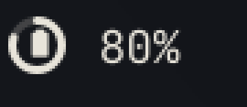
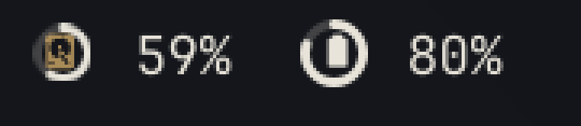
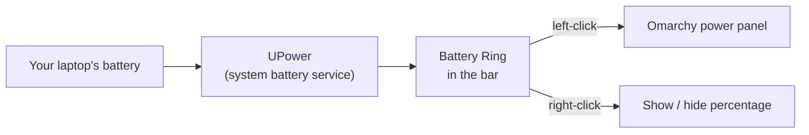

<div align="center">

<h1>🔋 Battery Ring</h1>

<h4>See your battery at a glance in the Omarchy bar: a ring that fills with your charge, a battery icon inside, and the exact percentage beside it.</h4>

<a href="https://github.com/sudharamachandranrajeev/omarchy-battery-ring/blob/main/LICENSE"></a>


<p>
  <a href="#-what-it-does">What it does</a> •
  <a href="#-get-started">Get started</a> •
  <a href="#-how-it-works">How it works</a> •
  <a href="#-faq-and-troubleshooting">FAQ</a> •
  <a href="#%EF%B8%8F-for-developers">For developers</a>
</p>



</div>

Battery Ring replaces the battery icon in the [Omarchy](https://omarchy.org) top bar. The stock icon only gives you a rough level. Battery Ring shows the level as a ring, so you can read it at a glance, and adds the exact number next to it. It is an early release (alpha). It only works on laptops, because desktops have no battery to show.

## ✨ What it does

- 🔵 **Charge ring** – the ring fills clockwise from the top as your battery charges.
- 🔋 **Battery icon inside** – you can tell it is the battery, even next to other rings in the bar such as a storage ring.
- ⚡ **Charging bolt** – while plugged in and charging, the icon shows a lightning bolt.
- 🔴 **Low-battery warning** – on battery power, the ring turns reddish at 30% and fully red at 15%.
- 🔢 **Exact percentage** – shown to the right of the ring. Right-click hides or shows it.
- 🧭 **Same power panel** – left-click still opens Omarchy's own panel with power profiles, battery health and system stats.
- 🌍 **Your language** – numbers and labels follow the language you picked in Omarchy.

<details>
<summary>📸 Next to a storage ring (Bhandara)</summary>



The storage ring comes from [Bhandara](https://github.com/sudharamachandranrajeev/bhandara). Each ring has its own icon, so the two don't get mixed up.

</details>

## 🚀 Get started

You need Omarchy on a laptop. Open a terminal and follow these steps in order.

1. **Add the widget.** This downloads Battery Ring into `~/.config/omarchy/plugins/battery-ring.bar` and places it on the bar:

   ```bash
   omarchy plugin add https://github.com/sudharamachandranrajeev/omarchy-battery-ring --enable
   ```

2. **Turn off the stock battery icon**, so you don't see two batteries:

   ```bash
   omarchy plugin disable omarchy.power
   ```

3. **Move the ring where you want it** (optional). For example, to put it at the right end of the bar:

   ```bash
   omarchy bar move battery-ring.bar --section right
   ```

The bar updates by itself. If the ring doesn't appear, run `omarchy restart shell`.

**Updating:** `omarchy plugin update battery-ring.bar`

**Removing:** run `omarchy plugin remove battery-ring.bar`, then `omarchy plugin enable omarchy.power` to get the stock icon back.

## 🧭 How it works



- The charge level comes from UPower, the same battery service that Omarchy's own widget uses. Nothing is sent anywhere.
- The ring is drawn on a small canvas, and the icon inside is a Nerd Font glyph from your bar font.
- Everything else is Omarchy's stock power widget, unchanged: the panel, power profiles and keyboard controls.

## ❓ FAQ and troubleshooting

<details>
<summary>I see two battery icons</summary>

The stock widget is still on. Run `omarchy plugin disable omarchy.power`.
</details>

<details>
<summary>The ring doesn't show up at all</summary>

The ring only appears when a battery is found, so it stays hidden on a desktop PC. On a laptop, run `omarchy restart shell`. Then check that `upower -e` lists a `battery_BAT…` device.
</details>

<details>
<summary>I edited the files but the bar didn't change</summary>

Omarchy sometimes keeps the old version loaded. Run `omarchy restart shell`.
</details>

<details>
<summary>Can I hide the percentage?</summary>

Yes. Right-click the ring. Right-click again to bring it back. Your choice is saved in `~/.config/omarchy/shell.json`.
</details>

<details>
<summary>The ring turned red</summary>

You are on battery power and the charge is at or below 15%. Plug in your charger. Between 15% and 30%, the ring is tinted reddish as an early warning.
</details>

## 🛠️ For developers

<details>
<summary>Files and editing</summary>

| File | What it is |
| --- | --- |
| `manifest.json` | Plugin id `battery-ring.bar`. `clonedFrom: omarchy.power` sends Omarchy's power keyboard shortcuts and IPC calls to this widget. |
| `Panel.qml` | Omarchy's power widget, with the bar button replaced by the ring and the percentage. |
| `BatteryRing.qml` | The ring (track, charge arc) and the battery or charging glyph. |
| `Model.js` | Omarchy's battery and power-profile helpers, unchanged. |

The ring is placed over the bar button at `Style.bar.iconSize + 2` px, not through `iconComponent`. This is because the bar shrinks icon components to a 12 px box, which leaves the glyph cramped.

To work on it, edit the files in `~/.config/omarchy/plugins/battery-ring.bar/`. The shell reloads on save. If a change doesn't show, run `omarchy restart shell`. To check the manifest, run `omarchy plugin validate .`.
</details>

## Credits

Built on Omarchy's power widget (`omarchy.power`), © David Heinemeier Hansson, MIT licence. The ring style matches the storage ring in [Bhandara](https://github.com/sudharamachandranrajeev/bhandara).

## License

[MIT](LICENSE)

> GitHub [@sudharamachandranrajeev](https://github.com/sudharamachandranrajeev)
